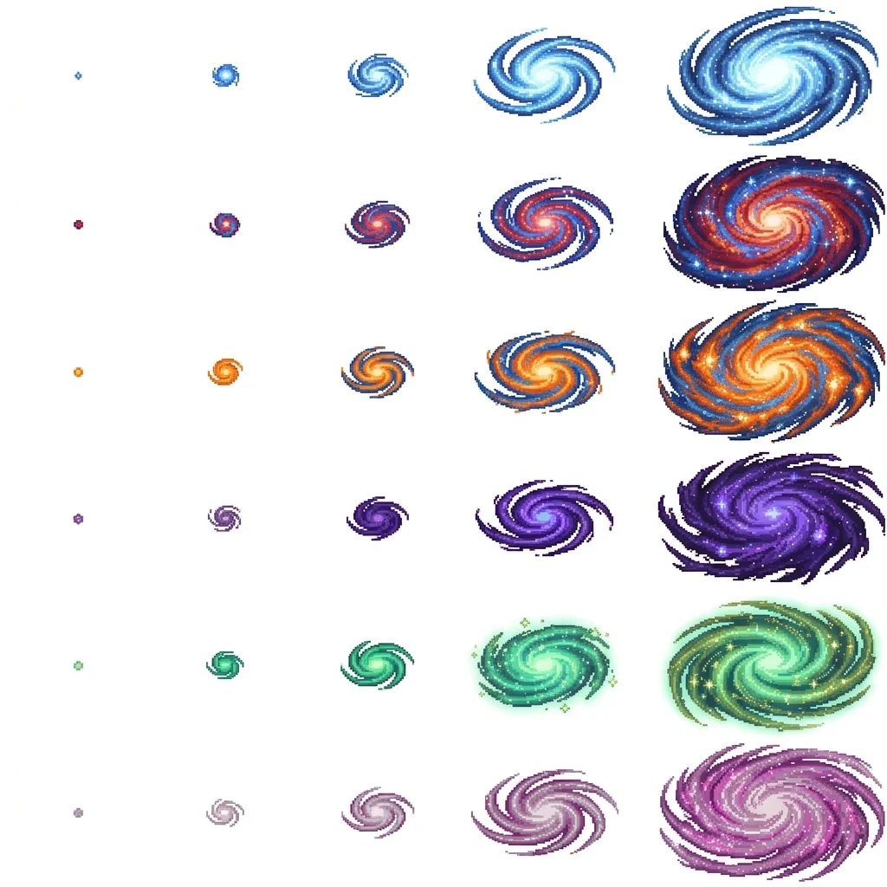

# Gitlaxy

Pixel-art galaxies for a GitHub profile: six colorways, five growth stages, and
a light and dark version for GitHub's page colors.

<p align="center">
  <picture>
    <source media="(prefers-color-scheme: dark)" srcset="docs/galax-black.png" />
    
  </picture>
</p>

The sheet holds the blue, red, orange, purple, green, and pink galaxy, from a
single spark to a full spiral. `docs/galax-black.png` is drawn for dark pages and
`docs/galax-white.png` for light ones.

## Repository Structure

```text
.
└── docs/     the galaxy sheet in dark and light page colors
```
