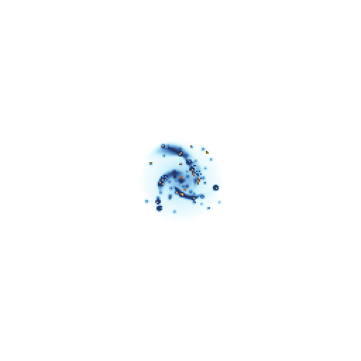

# Gitlaxy

Pixel-art galaxies for a GitHub profile, drawn from public activity: six colorways,
five growth stages, seamless eight-second loops, and a light and a dark version for
GitHub's page colors.

<p align="center">
  <picture>
    <source media="(prefers-color-scheme: dark)" srcset="docs/demo/galaxy-dark.gif" />
    
  </picture>
</p>

The loop above is the committed demo, generated on 2026-11-11 from
[`salmonenjoyer68`](https://github.com/salmonenjoyer68): **blue** colorway, **stage 2**
of five, **active** motion (no quiet days in the recent run). See it on both page colors
at [`docs/demo/preview.html`](docs/demo/preview.html), or download the assets directly:

| File | Contents |
| --- | --- |
| [`galaxy-dark.gif`](docs/demo/galaxy-dark.gif) | 120-frame, 8-second dark-page loop |
| [`galaxy-light.gif`](docs/demo/galaxy-light.gif) | 120-frame, 8-second light-page loop |
| [`galaxy-dark.png`](docs/demo/galaxy-dark.png) | dark-page still |
| [`galaxy-light.png`](docs/demo/galaxy-light.png) | light-page still |
| [`preview.html`](docs/demo/preview.html) | both themes side by side, no scripts |

## The galaxy sheet

<p align="center">
  <picture>
    <source media="(prefers-color-scheme: dark)" srcset="docs/galax-black.png" />
    
  </picture>
</p>

The sheet is the catalog: the blue, red, orange, purple, green, and pink galaxy, each
from a single spark to a full spiral. `docs/galax-black.png` is drawn for dark pages and
`docs/galax-white.png` for light ones.

A galaxy grows with the account's contribution total: stage 1 from 0, stage 2 from 250,
stage 3 from 750, stage 4 from 1,250, and stage 5 from 1,500 contributions. A quiet
streak of 14 or more days dims it to *quiet* motion; otherwise it is *active*, with
denser twinkle, a denser inward drift of dust motes, and two seeded flares per
loop. The colorway is purely cosmetic; stages and motion come from the data.

## Requirements

- Rust 1.88 or newer, to build the binary.
- An authenticated GitHub CLI (`gh`) for collection, or a `GH_TOKEN` environment
  variable holding a token that can read public data.

```sh
cargo build --release --locked
```

## Collect

```sh
gitlaxy collect LOGIN --output FILE
```

Collects `LOGIN`'s public snapshot — owned and contributed repositories, language
colors, and daily contributions from the account's creation through yesterday (UTC) —
and writes it as JSON. Without `--output`, the snapshot goes to standard output. The
file is replaced only after collection succeeds.

```sh
gh auth login                                  # or: export GH_TOKEN=...
./target/release/gitlaxy collect octocat --output snapshot.json
```

## Render

```sh
gitlaxy render SNAPSHOT --output-dir DIR [--colorway COLORWAY]
```

Renders `SNAPSHOT` into `DIR`:

| File | Contents |
| --- | --- |
| `galaxy-dark.png` | 512×512 still on the dark page background (`#0d1117`) |
| `galaxy-light.png` | 512×512 still on the light page background (`#ffffff`) |
| `galaxy-dark.gif` | 512×512, 120-frame, 8-second loop at 15 fps, drawn for dark pages |
| `galaxy-light.gif` | 512×512, 120-frame, 8-second loop at 15 fps, drawn for light pages |
| `preview.html` | a script-free page showing all four images on their themes |

`COLORWAY` is `blue` (the default), `red`, `orange`, `purple`, `green`, or `pink`; an
unknown value is a usage error. All files are rendered in memory and replaced only
after every one succeeds, so a failed run leaves the previous outputs untouched.

```sh
./target/release/gitlaxy render snapshot.json --output-dir galaxy --colorway blue
```

## GitHub Action

The repository ships a composite Action declared in [`action.yml`](action.yml), which
downloads the matching release binary and runs it. Point the workflow at a release tag,
not a moving branch:

```yaml
- uses: salmonenjoyer68/Gitlaxy@v0.1.0
  with:
    login: octocat          # defaults to the repository owner
    colorway: blue          # blue, red, orange, purple, green, or pink
    output-dir: galaxy      # folder receiving the five files
    token: ${{ github.token }}
```

The included [`profile.yml`](.github/workflows/profile.yml) workflow does not use that
Action: it builds the binary from source with `cargo build --release --locked`. It runs
nightly at 00:20 UTC and on manual dispatch, with `login`, `colorway`, `output-dir`, and
`token` dispatch inputs. It collects the owner's public snapshot, renders the five files
into the workspace, and commits **only** `galaxy-dark.gif` and `galaxy-light.gif`, so a
profile README can embed the loops without churning the stills and preview.

## License

MIT. Gitlaxy is derived from [git-koi](https://github.com/yalongwastaken/git-koi) by
Anthony Yalong, used under the MIT License; the full text is in [LICENSE](LICENSE) and
the attribution in [NOTICE](NOTICE).
